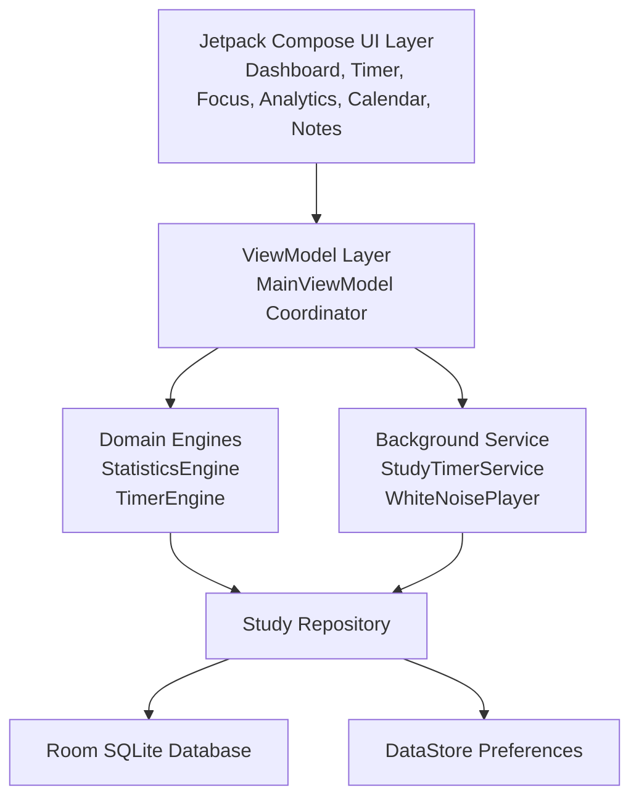

<div align="center">

# ⏱️ Focentra

### Distraction-Free Offline Study Timer & Deep Work Analytics for Android

[](https://developer.android.com)
[](https://kotlinlang.org)
[](https://developer.android.com/jetpack/compose)
[](#-privacy--offline-first-guarantee)
[](https://github.com/craftplex/Focentra/actions)
[](https://github.com/craftplex/Focentra/releases)
[](LICENSE)

<br/>

<p>
  <a href="#-download-focentra"></a>
  <a href="#-key-features"></a>
  <a href="#-project-architecture"></a>
</p>

<p>
  <strong>Focentra</strong> is a privacy-first, distraction-free study and deep work app for Android designed for students, researchers, engineers, and serious learners.
  It helps you focus, track your progress, and understand your concentration patterns without any cloud dependency, account sign-up, or invasive tracking.
</p>

<p>
  
  
  
</p>

</div>

<div align="center">

<svg width="900" height="180" viewBox="0 0 900 180" xmlns="http://www.w3.org/2000/svg" role="img" aria-label="Animated focus signal">
  <defs>
    <linearGradient id="bgGlow" x1="0%" x2="100%" y1="0%" y2="0%">
      <stop offset="0%" stop-color="#111827"/>
      <stop offset="50%" stop-color="#171f2f"/>
      <stop offset="100%" stop-color="#0f172a"/>
    </linearGradient>
    <linearGradient id="ringGlow" x1="0%" x2="100%" y1="0%" y2="100%">
      <stop offset="0%" stop-color="#22d3ee"/>
      <stop offset="50%" stop-color="#a78bfa"/>
      <stop offset="100%" stop-color="#34d399"/>
    </linearGradient>
  </defs>
  <rect x="0" y="0" width="900" height="180" rx="20" fill="url(#bgGlow)"/>
  <g>
    <circle cx="100" cy="90" r="34" fill="none" stroke="url(#ringGlow)" stroke-width="4" opacity="0.8">
      <animate attributeName="r" values="28;38;28" dur="2.5s" repeatCount="indefinite"/>
      <animate attributeName="opacity" values="0.5;1;0.5" dur="2.5s" repeatCount="indefinite"/>
    </circle>
    <circle cx="100" cy="90" r="12" fill="#22d3ee" opacity="0.9"/>
    <path d="M150 90h150" stroke="#38bdf8" stroke-width="6" stroke-linecap="round" opacity="0.8">
      <animate attributeName="stroke-width" values="4;8;4" dur="1.8s" repeatCount="indefinite"/>
    </path>
    <path d="M330 90h220" stroke="#a78bfa" stroke-width="6" stroke-linecap="round" opacity="0.8">
      <animate attributeName="stroke-dasharray" values="0 30;24 30;0 30" dur="2.2s" repeatCount="indefinite"/>
    </path>
    <path d="M580 90h170" stroke="#34d399" stroke-width="6" stroke-linecap="round" opacity="0.8"/>
    <circle cx="770" cy="90" r="18" fill="none" stroke="#34d399" stroke-width="4">
      <animate attributeName="r" values="14;22;14" dur="2s" repeatCount="indefinite"/>
      <animate attributeName="opacity" values="0.7;1;0.7" dur="2s" repeatCount="indefinite"/>
    </circle>
  </g>
  <text x="450" y="155" text-anchor="middle" font-size="20" font-family="Segoe UI, sans-serif" fill="#e2e8f0" letter-spacing="3">FOCUS • TRACK • IMPROVE</text>
</svg>

</div>

---

## 📖 Table of Contents

- [💡 Why Focentra?](#-why-focentra)
- [🚀 Key Features](#-key-features)
- [📸 Screenshots & Visual Preview](#-screenshots--visual-preview)
- [📥 Download Focentra](#-download-focentra)
  - [Latest APK Release](#latest-apk-release)
  - [Installation Guide](#installation-guide)
- [🔌 Daynexa Integration (API v1)](#-daynexa-integration-api-v1)
- [🔒 Privacy & Offline-First Guarantee](#-privacy--offline-first-guarantee)
- [🏛️ Project Architecture](#️-project-architecture)
  - [Architecture Flow Diagram](#architecture-flow-diagram)
  - [Layer Breakdown](#layer-breakdown)
- [💻 Tech Stack & Libraries](#-tech-stack--libraries)
- [🗄️ Local Database Model](#️-local-database-model)
- [🔄 Backup, Import & Export](#-backup-import--export)
- [🛠️ Setup Instructions for Developers](#-setup-instructions-for-developers)
  - [Workstation Prerequisites](#workstation-prerequisites)
  - [Cloning and Building](#cloning-and-building)
- [🧪 Testing & Quality Assurance](#-testing--quality-assurance)
- [🤖 GitHub Actions & CI/CD Pipeline](#-github-actions--cicd-pipeline)
- [🗺️ Roadmap](#️-roadmap)
- [📝 Changelog](#-changelog)
- [🐛 Reporting Issues & Feature Requests](#-reporting-issues--feature-requests)
- [🤝 Contributing](#-contributing)
- [📄 License](#-license)
- [👨‍💻 Author & Developer](#-author--developer)
- [📬 Contact & Community](#-contact--community)

---

## 💡 Why Focentra?

Modern productivity apps are often bloated with mandatory sign-ins, intrusive push notifications, aggressive subscriptions, and cloud tracking.

Focentra takes a different approach:

- Zero friction: open the app and begin studying immediately.
- Full ownership: your sessions, notes, analytics, streaks, and subjects live locally on your device.
- Deep work focus: customizable timer modes, ambient sound, and distraction shields built for concentration.
- Actionable insight: visual analytics uncover peak study windows, consistency, and performance trends.
- 100% local-first: no cloud sync, no third-party analytics, no ads, no login wall.

---

## 🚀 Key Features

| Category | Highlights |
| :--- | :--- |
| ⏱️ Timer Engine | Countdown, stopwatch, and Pomodoro modes with flexible presets, session logging, and precise timing control. |
| 📈 Analytics | 16-week heatmap, daily/weekly/monthly summaries, hourly focus curves, focus score intelligence, and streak tracking. |
| 🧠 Active Recall | 3D flip-card study decks, mastery progression, performance analytics, and repeat-optimized learning loops. |
| 📝 Brain Dump | Capture distracting thoughts instantly while staying in your focus flow. |
| 🌙 Focus Mode | Full-screen AMOLED-friendly focus view with unobtrusive controls and anti-burn-in behavior. |
| 📚 Subjects & Topics | Organize study by subjects, subtopics, color, icons, and targets. |
| 🏆 Habit System | Daily streaks, milestones, badges, and unlockable achievements. |
| 📅 History | Searchable session log, monthly calendar, exportable data, and contextual session review. |
| 🛡️ Data Portability | Full JSON backup, clipboard integration, and CSV export for Excel, Sheets, and analysis tools. |
| 🎨 Personalization | Material Design 3 dynamic theming, custom reminders, and aesthetic subject customization. |
| 🔊 Audio Support | Ambient white noise and soundscapes to reduce environmental distraction. |
| 🔌 App-to-App Integration | Daynexa session sharing via provider + broadcast contracts on-device. |

---

## 📸 Screenshots & Visual Preview

<div align="center">

| Dashboard & Goal | Active Focus Timer | Immersive OLED Mode |
| :---: | :---: | :---: |
|  |  |  |

| Multi-Period Analytics | Study Heatmap & History | Subjects & Targets |
| :---: | :---: | :---: |
|  |  |  |

</div>

---

## 📥 Download Focentra

### Latest APK Release

You can download the latest Android APK directly from the official release channel:

| Release Method | Location | Compatibility | Link |
| :--- | :--- | :--- | :--- |
| Official GitHub Release | GitHub Releases | Android 7.0+ (API 24+) | [Releases Page](https://github.com/craftplex/Focentra/releases) |
| Automated CI Build | GitHub Actions Artifacts | Android 7.0+ (API 24+) | [Actions Artifacts](https://github.com/craftplex/Focentra/actions) |

### Installation Guide

1. Go to [GitHub Releases](https://github.com/craftplex/Focentra/releases) or the [GitHub Actions](https://github.com/craftplex/Focentra/actions) tab.
2. Download the APK file (`focentra-v8.0.0-release.apk` or a debug artifact).
3. Open your device’s Downloads folder and tap the APK.
4. If prompted, enable “Install unknown apps” in Android settings.
5. Install and launch Focentra.

> Tip: If you’re testing a debug build, make sure your device allows app installs from unknown sources.

---

## 🔌 Daynexa Integration (API v1)

Focentra supports a secure, privacy-preserving app-to-app integration with Daynexa via a local Android ContentProvider and a broadcast-based session completion signal.

```text
┌────────────────────────┐      Local IPC / Binder      ┌────────────────────────┐
│        DAYNEXA         │ ───────────────────────────> │        FOCENTRA        │
│   Companion App        │  content://com.focentra.     │  DaynexaSessions       │
│                        │       provider/sessions      │      Provider (v1)     │
└────────────────────────┘                              └───────────┬────────────┘
            ▲                                                       │
            │           Secure Broadcast (Push)            User Consent Check
            └────────────────────────────────────────────── (Settings Enabled?)
                 com.focentra.ACTION_SESSION_COMPLETED              │
                                                                    ▼
                                                        ┌────────────────────────┐
                                                        │  Room SQLite Database  │
                                                        │      study_sessions    │
                                                        └────────────────────────┘
```

### Integration Contract

| Specification | Value |
| :--- | :--- |
| API Version | `1` |
| Provider Authority | `com.focentra.provider` |
| Sessions Endpoint | `content://com.focentra.provider/sessions` |
| Single Item Endpoint | `content://com.focentra.provider/sessions/#` |
| Broadcast Action | `com.focentra.ACTION_SESSION_COMPLETED` |
| Security Permission | `com.focentra.permission.READ_SESSIONS` |
| Access Mode | Read-only |

### Exposed Session Schema

| Column / Key | Type | Purpose |
| :--- | :--- | :--- |
| `sessionId` | `Long` | Unique session identifier |
| `subject` | `String` | Subject label |
| `topic` | `String` | Topic or subtopic |
| `startTime` | `Long` | Start timestamp in epoch ms |
| `endTime` | `Long` | End timestamp in epoch ms |
| `duration` | `Long` / `Int` | Focused study duration in minutes |
| `completionStatus` | `String` | `COMPLETED`, `EARLY_FINISH`, or `CANCELLED` |
| `focusScore` | `Int` | Algorithmic focus score from `0-100` |
| `schemaVersion` | `Int` | API schema version |

### Security & Consent Control

- User consent must be enabled under Settings → Integrations → Daynexa.
- Provider and broadcast endpoints are read-only.
- Inserts, updates, and deletes are rejected.
- Broadcast delivery is permission-gated using `com.focentra.permission.READ_SESSIONS`.
- Data never leaves the device and is shared only through local Android IPC mechanisms.

---

## 🔒 Privacy & Offline-First Guarantee

```text
┌─────────────────────────────────────────────────────────────┐
│                 FOCENTRA PRIVACY CONTRACT                   │
├─────────────────────────────────────────────────────────────┤
│  ✓  No account or login required                           │
│  ✓  No cloud synchronization                               │
│  ✓  No analytics SDKs or ad networks                       │
│  ✓  No AI, server processing, or remote tracking           │
│  ✓  No background data transmissions                      │
│  ✓  100% of your notes, metrics, and timers stay local     │
└─────────────────────────────────────────────────────────────┘
```

All data is stored in a local SQLite database managed by AndroidX Room. You own your study history completely and can export it as JSON or CSV at any moment.

---

## 🏛️ Project Architecture

Focentra is built using Clean Architecture, MVVM, and unidirectional data flow principles.

### Architecture Flow Diagram



### Layer Breakdown

1. Presentation Layer (`com.niloy.focentra.ui`)
   - Jetpack Compose + Material 3 UI
   - Dashboard, timer, analytics, calendar, subjects, achievements, settings
2. State & Orchestration Layer (`com.niloy.focentra.viewmodel`)
   - `MainViewModel` exposes immutable reactive state via `StateFlow`
3. Domain Engines (`com.niloy.focentra.engine`)
   - `StatisticsEngine` generates focus scores, heatmaps, and multi-period summaries
   - `TimerEngine` manages countdown, stopwatch, and Pomodoro transitions
4. Service & Background Layer (`com.niloy.focentra.service`)
   - Foreground service keeps sessions running reliably in the background
   - Ambient white noise system runs with low-latency playback
5. Data & Storage Layer (`com.niloy.focentra.data`)
   - `StudyRepository` orchestrates DAOs, DataStore, and business logic
   - `AppDatabase` stores app state using Room SQLite

> For deeper technical documentation, check the architecture guide: [docs/architecture/ARCHITECTURE.md](docs/architecture/ARCHITECTURE.md)

---

## 💻 Tech Stack & Libraries

- Kotlin 2.0+
- Jetpack Compose + Material Design 3
- MVVM + Clean Architecture + UDF
- AndroidX Room 2.6+ with SQLite
- KSP (Kotlin Symbol Processing)
- DataStore Preferences
- Coroutines + Flow
- Moshi + org.json
- JUnit 4, Robolectric, Kotlinx Coroutines Test, Roborazzi

---

## 🗄️ Local Database Model

```text
Room Database: "focentra_study_db"
├── study_sessions     (Session timing, productivity rating, pauses, notes, mood)
├── subjects           (Subject names, color codes, icons, target hours)
├── topics             (Sub-topics associated with subjects)
├── timer_presets      (Custom countdown and Pomodoro presets)
├── reminders          (Daily reminder schedules and repeat days)
├── achievements       (Unlocked milestones and timestamps)
└── settings           (App preferences and user configuration)
```

---

## 🔄 Backup, Import & Export

Focentra includes full data portability under Settings → Data & Backup:

1. Full JSON backup for all sessions, subjects, and app data
2. Clipboard-based import/export support
3. CSV export for spreadsheet analysis in Excel, Google Sheets, or Notion
4. Exportable daily progress data for offline reporting and personal review

---

## 🛠️ Setup Instructions for Developers

### Workstation Prerequisites

- JDK 17 (Temurin recommended)
- Android Studio Ladybug (2024.2.1+) or newer
- Android SDK with API level 36
- Minimum SDK: 24
- Git 2.30+

### Cloning and Building

```bash
git clone https://github.com/craftplex/Focentra.git
cd Focentra
cp .env.example .env
```

#### Build debug APK

```bash
# macOS / Linux
./gradlew assembleDebug

# Windows
./gradlew.bat assembleDebug
```

#### Run unit tests

```bash
# macOS / Linux
./gradlew testDebugUnitTest

# Windows
./gradlew.bat testDebugUnitTest
```

---

## 🧪 Testing & Quality Assurance

```bash
gradle testDebugUnitTest
gradle testDebugUnitTest --stacktrace
```

Coverage focuses on:

- `StatisticsEngineTest`: focus score logic, streak validation, and boundary behavior
- `TimerEngineTest`: countdown transitions and pause tracking
- `StudyRepositoryTest`: backup restore, CSV generation, and deserialization validation

---

## 🤖 GitHub Actions & CI/CD Pipeline

The repository includes automated build and validation workflows:

- `.github/workflows/android-ci.yml`: compiles the project and runs unit tests on push and PR
- `.github/workflows/build-release-apk.yml`: builds signed APKs and attaches them to releases

---

## 🗺️ Roadmap

- [x] v1.0.0 — Core timer modes: Countdown, Stopwatch, Pomodoro
- [x] v1.0.0 — Advanced analytics: heatmap, focus summaries, streaks
- [x] v1.0.0 — Soundscapes and OLED focus mode
- [x] v1.0.0 — Data portability and JSON/CSV export
- [x] v1.2.1 — Active recall flashcards
- [x] v1.2.1 — Focus brain dump and distraction shield
- [x] v1.2.1 — Shareable performance card export
- [x] v1.3.1 — UI polish and interaction refinements
- [ ] v1.4.0 — Glance AppWidget
- [ ] v2.0.0 — Wear OS companion app

> See [ROADMAP.md](ROADMAP.md) for more details.

---

## 📝 Changelog

See [CHANGELOG.md](CHANGELOG.md) for the full release history and notes.

---

## 🐛 Reporting Issues & Feature Requests

- Bug reports: [Issue template](.github/ISSUE_TEMPLATE/bug_report.md)
- Feature requests: [Feature request template](.github/ISSUE_TEMPLATE/feature_request.md)
- Security disclosure: [SECURITY.md](SECURITY.md)

---

## 🤝 Contributing

Contributions are welcome.

1. Read the [Code of Conduct](CODE_OF_CONDUCT.md)
2. Review the [Contributing Guide](CONTRIBUTING.md)
3. Open a PR using the repository template

---

## 📄 License

Focentra is licensed under the [MIT License](LICENSE).

---

## 👨‍💻 Author & Developer

**Niloy Mitra**  
Student Developer & Software Engineer  
GitHub: [@Niloy-Track-Dev](https://github.com/Niloy-Track-Dev)  
Email: `niloymitra889@gmail.com`

---

## 📬 Contact & Community

- Repository: [craftplex/Focentra](https://github.com/craftplex/Focentra)
- Releases: [GitHub Releases](https://github.com/craftplex/Focentra/releases)
- Issues: [GitHub Issues](https://github.com/craftplex/Focentra/issues)
- Discussions: [GitHub Discussions](https://github.com/craftplex/Focentra/discussions)
- Email: `niloymitra889@gmail.com`

---

<div align="center">

<p><strong>Built with ❤️ and Kotlin for focused learners everywhere.</strong></p>

<a href="#-table-of-contents">⬆ Back to Top</a>

</div>
